# Space Invaders: preparazione del progetto

Progetto del corso di Programmazione, A.A. 2026/2027.

Lo script di setup crea la cartella del progetto. Poi installa gli strumenti che mancano: compilatore, CMake e la libreria curses. Prima di installare chiede sempre conferma.

Nella cartella del progetto c'è lo script `check`, da lanciare per compilare. Ogni volta:

1. aggiorna gli script, se è uscita una versione nuova;
2. controlla gli strumenti;
3. controlla che il codice rispetti le regole del progetto: solo le librerie consentite, una classe per coppia `include/NomeClasse.hpp` + `src/NomeClasse.cpp`;
4. compila.

Serve una connessione a internet. Seguite le istruzioni del vostro sistema:

- [Windows](#windows)
- [macOS](#macos)
- [Linux](#linux)

## Windows

### 1. Avviare il setup

Scaricate [setup-windows.bat](https://github.com/SIJ82/spaceinvaders-tools/releases/latest/download/setup-windows.bat) e apritelo con un doppio click. Il progetto viene creato accanto al file, nella cartella `spaceinvaders`: se il file è in Download, il progetto sarà in `Download\spaceinvaders`. Spostate il file in un'altra cartella prima di aprirlo, se volete il progetto altrove.

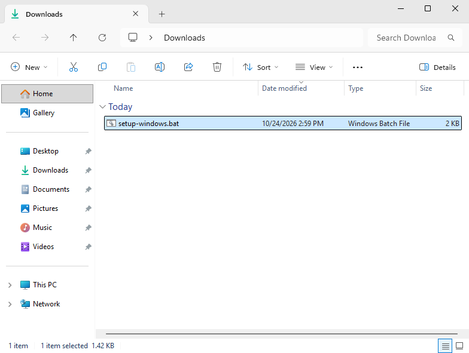

Windows potrebbe avvisare che il file viene da internet: confermate di volerlo eseguire.

### 2. Installare gli strumenti

Il setup elenca quello che manca e chiede se procedere: scrivete `s` e premete Invio.

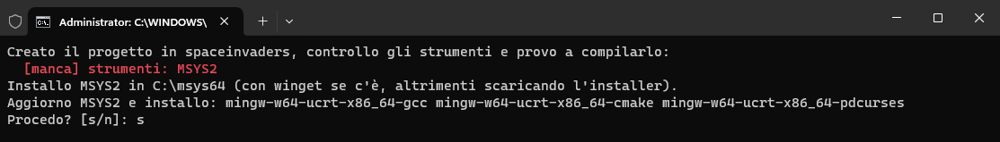

Lo script installa MSYS2 in `C:\msys64`, poi g++, CMake e PDCurses. La prima volta ci vogliono alcuni minuti. Alla fine compila il progetto di prova e scrive `Fatto.`.

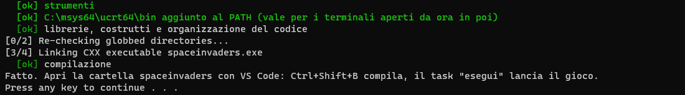

### 3. Compilare

Aprite un terminale nella cartella del progetto: in Esplora file, tasto destro dentro la cartella `spaceinvaders` → *Apri nel terminale* (su Windows 10: Maiusc + tasto destro → *Apri finestra di PowerShell qui*). Poi lanciate:

```
.\check.bat
```

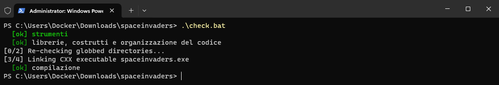

Se ci sono errori nel codice o regole non rispettate, `check` li elenca con file e riga e non compila.

### 4. Eseguire

```
.\check.bat --run
```

compila e lancia il gioco.

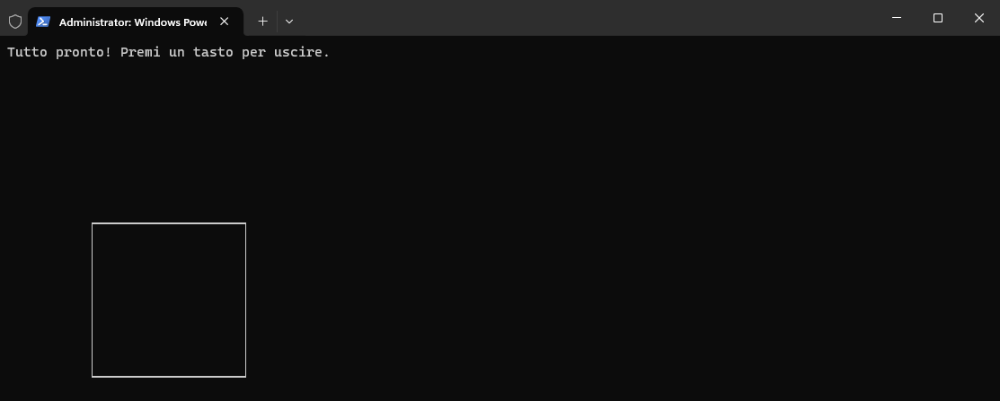

## macOS

### 1. Avviare il setup

Aprite il Terminale (Applicazioni → Utility → Terminale) e lanciate:

```
bash <(curl -fsSL https://github.com/SIJ82/spaceinvaders-tools/releases/latest/download/setup.sh)
```

Il progetto viene creato nella cartella `spaceinvaders` dentro la cartella in cui vi trovate (all'apertura del Terminale è la vostra home). Per un altro nome aggiungetelo in fondo al comando, ad esempio `... setup.sh) progetto`.

### 2. Installare gli strumenti

Il setup elenca quello che manca e chiede se procedere: scrivete `s` e premete Invio.

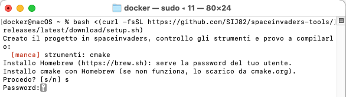

- Se mancano i **Command Line Tools** (il compilatore), si apre una finestra di installazione: cliccate *Installa*. Il setup aspetta che l'installazione finisca e poi prosegue da solo.
- **CMake** viene installato con Homebrew. Se Homebrew non funziona (ad esempio sui Mac Intel), lo script scarica CMake da cmake.org nella cartella `Applicazioni` della vostra home.
- Viene chiesta la password del Mac (`Password:`). Mentre la scrivete non compare nulla: è normale. Finite con Invio.

Alla fine il setup compila il progetto di prova e scrive `Fatto.`.

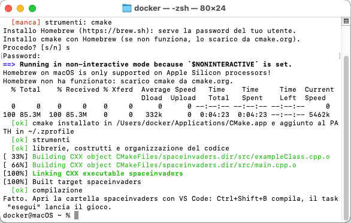

### 3. Compilare

Nel Terminale, dalla cartella del progetto:

```
cd spaceinvaders
bash check.sh
```

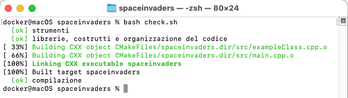

Se ci sono errori nel codice o regole non rispettate, `check` li elenca con file e riga e non compila.

### 4. Eseguire

```
bash check.sh --run
```

compila e lancia il gioco.

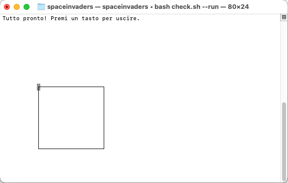

## Linux

### 1. Avviare il setup

Aprite un terminale e lanciate:

```
bash <(curl -fsSL https://github.com/SIJ82/spaceinvaders-tools/releases/latest/download/setup.sh)
```

Se `curl` non c'è, installatelo prima (su Ubuntu e Debian: `sudo apt install curl`).

Il progetto viene creato nella cartella `spaceinvaders` dentro la cartella in cui vi trovate. Per un altro nome aggiungetelo in fondo al comando, ad esempio `... setup.sh) progetto`.

### 2. Installare gli strumenti

Il setup mostra il comando che installa quello che manca (g++, CMake, make, ncurses) e chiede se eseguirlo: scrivete `s` e premete Invio. Verrà chiesta la vostra password, quella di `sudo`.

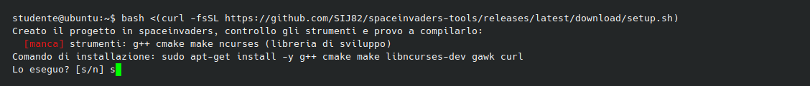

Sono supportate le distribuzioni con `apt` (Ubuntu, Debian, Mint), `dnf` (Fedora), `pacman` (Arch) e `zypper` (openSUSE). Su altre distribuzioni installate a mano i pacchetti indicati.

Alla fine il setup compila il progetto di prova e scrive `Fatto.`.

### 3. Compilare

Dalla cartella del progetto:

```
cd spaceinvaders
bash check.sh
```

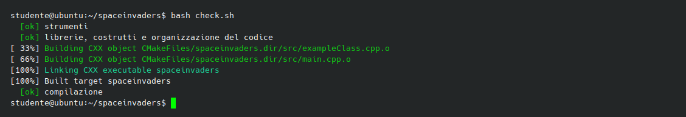

Se ci sono errori nel codice o regole non rispettate, `check` li elenca con file e riga e non compila.

### 4. Eseguire

```
bash check.sh --run
```

compila e lancia il gioco.

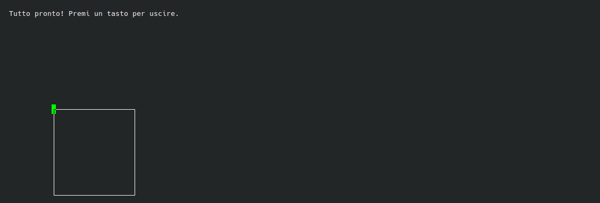

## Il progetto

```
spaceinvaders/
├── include/           gli header: NomeClasse.hpp
├── src/               i sorgenti: main.cpp e NomeClasse.cpp
├── CMakeLists.txt     la configurazione di CMake (non serve modificarla)
├── check.sh           controllo e compilazione (Linux e macOS)
├── check.bat          controllo e compilazione (Windows)
└── .scripts/          gli script usati da check: non modificateli
```

Il gioco compilato è in `build/spaceinvaders` (su Windows `build\spaceinvaders.exe`). `exampleClass` è una classe di esempio: modificatela o cancellatela.
